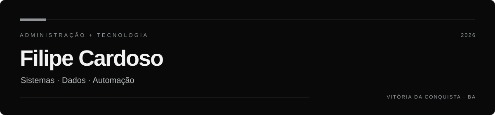

Sou de Vitória da Conquista, na Bahia. Trabalho como assistente administrativo na Afya, onde já acompanhei notas, frequência e pedidos de alunos de Medicina. Sou formado em Administração e hoje curso Análise e Desenvolvimento de Sistemas.

Um dos projetos que mais tem a ver com meu trabalho é o de [relatórios acadêmicos](https://github.com/Filipcardos/academic-report-automation). A ideia veio de uma tarefa familiar pra mim: conferir notas e preparar relatórios para a coordenação. Escrevi um programa em Python que busca os dados no SQL Server, calcula as médias por disciplina e gera os arquivos em Excel e PDF.

Também fiz um [monitor de APIs](https://github.com/Filipcardos/api-monitoring-system) para acompanhar quais serviços estão no ar e quanto tempo levam para responder. No [Amon AI](https://github.com/Filipcardos/amon-ai), dá para tirar dúvidas sobre finanças e simular quanto renderiam aportes mensais.

Hoje busco minha primeira oportunidade em sistemas ou análise de dados.

[Portfólio](https://filipe-cardoso.vercel.app/) · [LinkedIn](https://www.linkedin.com/in/filipe-cardoso-919532205/) · [E-mail](mailto:Ofilipe259@gmail.com)
